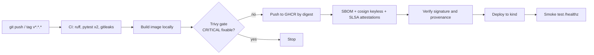

# GitHub Actions DevSecOps Lab

**A free, hands-on course and a working lab: every push is tested, scanned, signed, verified and deployed to a throwaway Kubernetes cluster with GitHub Actions.**

### ▶ [Start the interactive course](https://georgesmomo.github.io/devsecops-actions-lab/)

13 stations, about 10 hours at your own pace: annotated screenshots of this repository, clickable pipeline diagrams, a trigger simulator, a least-privilege permissions builder, quizzes after every station, a 20-question final exam and an 86-term glossary. Your progress is saved in your browser.

---

## Why this repository exists

I'm Georges MOMO, a DevSecOps engineer. I built this lab to learn GitHub Actions in depth, in public, and to give others something most tutorials don't: a **real, working DevSecOps pipeline** that you can read line by line, fork, break and fix.

Most CI/CD examples stop at "the tests are green". In companies, a pipeline also has to prove that no secret leaked, that the container has no critical vulnerability you could fix, that the image running in the cluster is exactly the one that was built, and who approved the deployment. This repository does all of that with GitHub's native features and a handful of open-source tools, and the course explains every step: what it is, why it exists, how companies use it, and where its limits are.

If it helps you learn, land a job or prepare a certification, it did its job. A star or a fork tells me it was useful.

## What you will learn

- **GitHub itself**: repositories, issues and issue forms, pull requests, CODEOWNERS, rulesets, releases, Codespaces, editing from the browser.
- **GitHub Actions from the ground up**: events and filters, jobs, steps, runners, contexts and expressions, matrices, caches, artifacts, job outputs, concurrency, environments, secrets and variables.
- **Reuse**: reusable workflows (`workflow_call`), composite actions, starter workflows, action types and metadata.
- **Supply chain security**: gitleaks, dependency review, CodeQL, Dependabot, Trivy with a security gate, SBOM (Syft, SPDX), keyless signing with cosign and Sigstore, SLSA provenance attestations, deployment by digest, verification before deploy.
- **Hardening**: least-privilege `GITHUB_TOKEN`, SHA pinning and the actions lockfile, script injection, OIDC instead of stored keys, self-hosted runner risks.
- **Integrations and AI**: GitHub Apps (and when to prefer them over tokens), Copilot cloud agent, MCP servers, AI review inside a workflow with guardrails.
- **Certification**: a map of the GH-200 (GitHub Actions) domains to the stations and files of this lab.

## Who it is for

- Developers who want to understand the CI/CD pipeline they use every day.
- Ops, cloud and security engineers moving into DevSecOps.
- Anyone preparing the **GH-200 GitHub Actions** certification.

**Prerequisites:** a free GitHub account, basic git vocabulary (commit, branch) and the ability to read YAML. No local installation is required: the whole lab was built from the browser, and the pipeline runs on GitHub-hosted runners, which are free for public repositories. Docker and Kubernetes knowledge helps but is not required.

## How to use this repository to learn

| If you want to… | Do this |
|---|---|
| Understand the concepts | Follow the [interactive course](https://georgesmomo.github.io/devsecops-actions-lab/) station by station and take the quizzes. |
| Practise for real | Fork this repository, run the pipeline in your fork and do the hands-on blocks of each station (quick start below). |
| Prepare GH-200 | Read stations 5, 6, 9 and 12, redo their exercises, then take the final exam until you score 80% or more. |

## Learning path

| Station | Topics | Time |
|---|---|---|
| 0. Welcome aboard | DevSecOps, what the lab does, how to follow the course | 15 min |
| 1. GitHub in 10 minutes | Core vocabulary, global bar, search, Marketplace, organizations, Copilot menu | 35 min |
| 2. A repository's tabs | Code page, branches and tags, releases, deployments, cloning, Codespaces, Insights | 35 min |
| 3. Issues and pull requests | Issue forms, pull request anatomy, CODEOWNERS, the fork trap | 40 min |
| 4. Working in the browser | New repository, workflow editor, committing, your first workflow | 20 min |
| 5. How Actions works | Events, jobs, steps, runners, triggers and filters, contexts, outputs, matrix, concurrency, reuse | 75 min |
| 6. Running and reading runs | Actions tab, manual runs, run graph, summaries, logs and debugging, caches vs artifacts, lockfile | 40 min |
| 7. The lab, file by file | The orchestrator, build-scan-push-sign, keyless signing, Dockerfile, hardened Kubernetes manifests | 80 min |
| 8. Security and supply chain | Dependabot, secret scanning, code scanning, GHCR, attestations, the six security rules | 55 min |
| 9. Settings that matter | Actions policies, GITHUB_TOKEN permissions, runners, environments, secrets, rulesets | 50 min |
| 10. GitHub Apps | Registration, installation, tokens, App vs PAT vs OIDC, build your own App | 45 min |
| 11. Copilot, agents, MCP | Cloud agent, automations, firewall, MCP servers, AI review with guardrails | 40 min |
| 12. Prepare GH-200 | Domain weights, YAML anchors, service containers, revision plan | 45 min |
| Final exam | 20 GH-200-style questions and five build challenges | 30 min |

## The pipeline

## Quick start in your fork

1. **Fork** this repository.
2. **Enable Actions** in your fork: Actions tab, "I understand my workflows, go ahead and enable them".
3. **Run the pipeline**: Actions, DevSecOps Pipeline, Run workflow (environment `staging`). The image is published to `ghcr.io/<your-account>/devsecops-actions-lab` with the job's own `GITHUB_TOKEN`; no secret is needed.
4. **Turn on the security features**: Settings, Advanced Security (Dependabot alerts and security updates, secret scanning, push protection), and Security, Overview, private vulnerability reporting.
5. **Add governance** (station 9): a `protect-main` ruleset with required checks, and a `production` environment with a required reviewer.
6. **Optional**: add a `COPILOT_PAT` secret to activate the AI pull request review (requires a Copilot licence).

## Repository structure

| Path | Role |
|---|---|
| `app/` | Minimal Flask API (`/` and `/healthz`), its tests and requirements (`gunicorn==22.0.0` is old on purpose) |
| `Dockerfile` | Multi-stage build, non-root user 10001, OCI labels, health check |
| `k8s/` | Hardened Deployment (non-root, read-only file system, no capabilities, probes, limits) and Service |
| `.github/workflows/` | The six workflows described below |
| `.github/actions/smoke-test/` | Local composite action: port-forward, HTTP call, assertion |
| `.github/dependabot.yml` | Weekly updates for pip, Docker and GitHub Actions |
| `.github/CODEOWNERS` | Mandatory reviewers for sensitive paths |
| `.github/ISSUE_TEMPLATE/`, `pull_request_template.md` | Issue form and DevSecOps checklist |
| `.github/copilot-instructions.md`, `AGENTS.md` | Instructions for AI coding agents |
| `.github/prompts/pr-review.prompt.yml` | Prompt of the AI review, which treats the diff as data |
| `SECURITY.md` | How to report a vulnerability privately |
| `docs/` | The interactive course (GitHub Pages) and the screenshots it uses |

## Workflows

| Workflow | Trigger | Role |
|---|---|---|
| `devsecops.yml` | push to `main` (filtered paths), tag `v*.*.*`, manual with inputs | Orchestrator: CI, then image, then verified deployment |
| `ci.yml` | pull request to `main`, `workflow_call`, manual | Lint (ruff), tests (matrix 3.12 / 3.13), gitleaks, dependency review |
| `reusable-docker.yml` | `workflow_call` | Build, Trivy report and gate, GHCR, SBOM, cosign, attestations |
| `codeql.yml` | push, pull request, weekly schedule | SAST on Python and on the workflows themselves |
| `ai-pr-review.yml` | pull request | AI review with Copilot, skipped for forks and without a secret |
| `copilot-setup-steps.yml` | manual, changes to itself | Environment of the Copilot coding agent |
| `pages.yml` | push to `main` on `docs/**`, manual | Publishes the interactive course to GitHub Pages |

## Exercises and challenges

- Change `MESSAGE` in `app/app.py` on a branch, open a pull request, watch the checks, merge and follow the deployment.
- Break a test on purpose and confirm that nothing gets built.
- Merge the Dependabot pull request for gunicorn and watch the Trivy alert close.
- Try an end-of-life base image in a pull request and read what the Trivy gate reports.
- Verify the published image yourself with `gh attestation verify` and `cosign verify`.
- Protect `main` with a ruleset and add an approval step for production.
- Create your own GitHub App and use it to open a pull request that the CI tests.
- Boss level: scan images on pull requests with `push: false`, replace a cloud key with OIDC, publish the smoke test as a Marketplace action.

Solutions and hints are in the course.

## Certification mapping (GH-200)

| GH-200 domain | Stations | Files to study |
|---|---|---|
| Build and manage workflows | 5, 6 | `devsecops.yml`, `ci.yml` |
| Use and troubleshoot workflows | 6 | run graph, logs, artifacts of any run |
| Build and manage actions | 5 | `.github/actions/smoke-test/action.yml` |
| Manage GitHub Actions for the enterprise | 9 | Settings, Actions; secrets, variables, runners, policies |
| Secure and optimize automation | 7, 8 | `reusable-docker.yml`, permissions blocks, SHA pinning |

Always check the [official GH-200 study guide](https://learn.microsoft.com/credentials/certifications/resources/study-guides/gh-200) for the current outline.

## Troubleshooting

| Symptom | Likely cause and fix |
|---|---|
| No workflow runs in your fork | Actions are disabled on new forks: enable them in the Actions tab. |
| Pushing to GHCR fails with 403 | The workflow permissions or the package settings deny writes: check `packages: write` on the job and the package's "Manage Actions access". |
| The pipeline did not start after a commit | The `paths` filter: only changes to `app/`, `Dockerfile`, `k8s/` or pipeline files trigger it. Use Run workflow. |
| The Trivy gate fails | A fixable CRITICAL CVE exists in the image: read the table in the gate step, then update the base image or the dependency. |
| `cosign verify` fails in your fork | The identity regexp uses `GITHUB_REPOSITORY`, so it must be the fork that built and signed the image. Re-run the build in your fork. |
| AI PR Review only prints a warning | The `COPILOT_PAT` secret is missing, which is expected without a Copilot licence. |
| Run workflow button missing | `workflow_dispatch` only works once the workflow is on the default branch. |

## The DevSecOps Learning Series

| Course | Lab repository | Interactive course |
|---|---|---|
| GitHub Actions DevSecOps (this one) | [georgesmomo/devsecops-actions-lab](https://github.com/georgesmomo/devsecops-actions-lab) | [Open](https://georgesmomo.github.io/devsecops-actions-lab/) |
| GitLab CI/CD DevSecOps | [georges.momo.n8n/devsecops-gitlab-lab](https://gitlab.com/georges.momo.n8n/devsecops-gitlab-lab) | [Open](__GITLAB_PAGES_URL__) |
| Kubernetes + Helm | [georgesmomo/k8s-helm-lab](https://github.com/georgesmomo/k8s-helm-lab) | [Open](https://georgesmomo.github.io/k8s-helm-lab/) |

## Contributing

Found a mistake, an outdated screenshot or a broken link? Open an issue or a pull request. Keep the lab's conventions: actions pinned by full SHA with the version in a comment, minimal `permissions:` in every workflow, no secret in code. Security issues go through private reporting, as described in [SECURITY.md](SECURITY.md).

## License

[MIT](LICENSE) © 2026 Georges MOMO. You are free to use, adapt and share the lab and the course, including in your own trainings.

## Author

**Georges MOMO**, DevSecOps engineer.
GitHub: [@georgesmomo](https://github.com/georgesmomo) · GitLab: [@georges.momo.n8n](https://gitlab.com/georges.momo.n8n)
