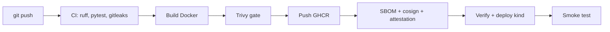

# devsecops-actions-lab

Labo GitHub Actions DevSecOps : API Flask -> image Docker -> scans -> SBOM -> signature -> deploiement Kubernetes ephemere (kind).

| Workflow | Declencheur | Role |
|---|---|---|
| `devsecops.yml` | push main, tag v*, manuel | pipeline complet |
| `ci.yml` | PR, appele | lint, tests (matrix), secrets, dependency review |
| `codeql.yml` | push, PR, hebdo | SAST Python + workflows |
| `reusable-docker.yml` | workflow_call | build, Trivy, GHCR, SBOM, cosign, attestations |
| `ai-pr-review.yml` | PR | revue IA (Copilot) |
| `copilot-setup-steps.yml` | manuel | environnement du Copilot coding agent |

Exercice : modifie `MESSAGE` dans `app/app.py`, commit sur une branche, ouvre une PR, merge -> deploiement automatique.
